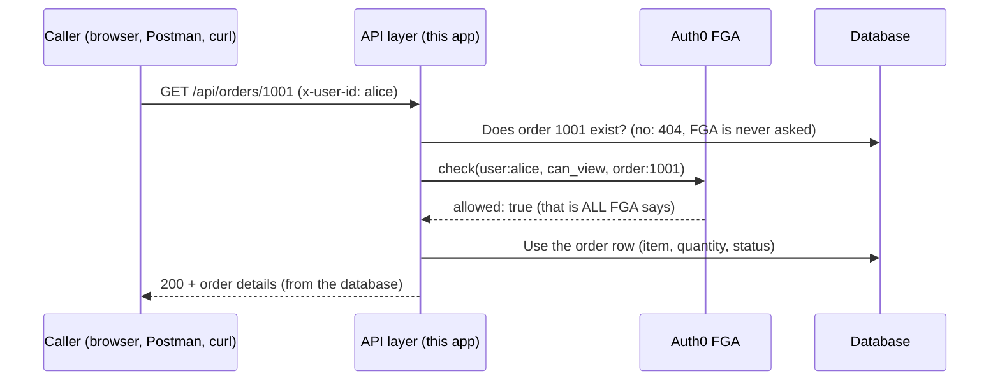
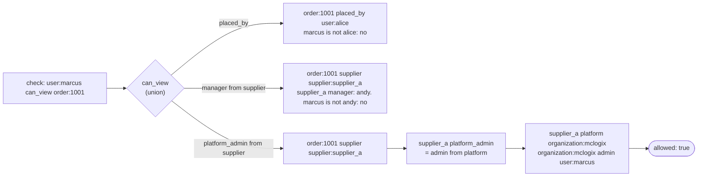

# McLogix 360: Auth0 FGA Workshop

A 90-minute enablement session on **Auth0 FGA** and relationship-based access control (ReBAC), built around a B2B supply-chain use case. Access is *computed from relationships*, and you will watch requests being correctly **allowed and blocked**.

> **DEMO ONLY.** Identity in this app comes from a spoofable `x-user-id` header, `/api/seed` is unauthenticated and destructive, and data lives in memory. Read [Security warnings](#security-warnings) before reusing any of it.

## The one idea to take away: FGA decides, the API serves the data

When you click **View** on a log entry in the app, or look at a response in Postman, it is easy to think *FGA sent you that order*. **It didn't.** FGA has never heard of "Canned tomatoes", "Orange juice" or a quantity of 40. It stores *relationships* and answers one question: "is this user related to this object in a way that grants this permission?" Everything else in the response comes from the application's own database, and it is the **API layer** that sits between the caller and FGA, asks the question, and decides what to return.

| | Auth0 FGA | API layer (this Next.js app) | Application database (in-memory here) |
|---|---|---|---|
| **Knows** | Relationships only, e.g. `user:alice placed_by order:1001`, `user:andy manager supplier:supplier_a` | Who the caller is, which question to ask FGA, how to shape the response | The business data: item (`Canned tomatoes`), quantity (`40`), status |
| **Never sees** | Item names, quantities, statuses, prices | Nothing in FGA's tuples | FGA tuples |
| **Produces** | `allowed: true / false` (or a list of object ids for `listObjects`) | `200` + data, `201`, `403`, `404`, `502` | Rows |

What really happens on `GET /api/orders/1001` as Alice:



If FGA answers `allowed: false`, the API layer stops there and returns **403 with no order data**. The row never leaves the database. The caller is never told FGA exists: they cannot call it, they hold no FGA credentials, and the API layer alone decides whether a "no" is a 403 or a 404. That is the point of putting authorization *behind* your API instead of in front of it.

**See it in the code** (line numbers are verified by `npm run check:refs`):

- `app/api/orders/[id]/route.ts:30`: unknown order, **404 comes from our database**; FGA is not even asked.
- `app/api/orders/[id]/route.ts:32`: the FGA `check`. It returns only `allowed`.
- `app/api/orders/[id]/route.ts:34`: FGA said no, so the API layer returns **403** and no order data.
- `app/api/orders/[id]/route.ts:45`: **FGA already said yes. This is where the `200` and the order details (item, quantity, status) are sent back, and they come from our database, not from FGA.**
- `app/api/orders/route.ts:26` and `:28`: the list endpoint. FGA's `listObjects` returns **only ids** (`order:1001`); the API layer then looks each one up in the database to build the rows.
- `app/api/orders/route.ts:49` and `:52`: creating an order. The database stores the item and quantity (`:49`); FGA is told only ids and relationships (`:52`).

> **Demo-only exception.** Every response in this workshop also carries an `fga` array (the check log). That is a teaching aid so you can *see* the decisions. A production API would not return FGA internals to callers.

## Contents

- [The one idea to take away](#the-one-idea-to-take-away-fga-decides-the-api-serves-the-data)
- [Quick start](#quick-start)
- [The scenario](#the-scenario)
- [Agenda](#agenda)
  - [Part 1 (0-15 min): Mental model](#part-1-015-min-mental-model)
  - [Part 2 (15-40 min): Dashboard and CLI](#part-2-1540-min-dashboard-and-cli)
  - [Part 3 (40-70 min): App and Postman](#part-3-4070-min-app-and-postman)
  - [Part 4 (70-80 min): Production practices](#part-4-7080-min-production-practices)
  - [Buffer and Q&A (80-90 min)](#buffer-and-qa-8090-min)
- [Exercises](#exercises)
- [Security warnings](#security-warnings)
- [Project layout](#project-layout)

## Quick start

**Prerequisites**

- Node.js (see `.nvmrc`; Node 20.9 or newer works) and npm
- An Auth0 FGA account and store: <https://dashboard.fga.dev>
- The `fga` CLI for Part 2 and the exercises: `brew install openfga/tap/fga`, or see the [CLI releases](https://github.com/openfga/cli). Docs: [How to use the FGA CLI](https://docs.fga.dev/getting-started/cli)

**Steps**

```bash
git clone <this repo> && cd <this repo>
npm i

# 1. Create API credentials in the dashboard: Settings -> Create Client.
#    The popup shows the Store ID, Client ID and Client Secret (the secret is shown once).
#    Guide: https://docs.fga.dev/integration/getting-your-api-keys
cp .env.example .env.local
#    ...fill in FGA_CLIENT_ID, FGA_CLIENT_SECRET, FGA_STORE_ID (and pick your region, see below)

# 2. Write the model, load the seed tuples, pin the model ID
npm run setup

# 3. Run the app
npm run dev        # http://localhost:3000
```

`npm run setup` is safe to re-run and only ever edits the `FGA_STORE_ID` / `FGA_MODEL_ID` lines of `.env.local` (it saves the previous contents to `.env.local.bak` first). **The client secret is shown only once in the dashboard, so also store it in your password manager.** It reuses the latest model if `fga/model.fga` has not changed, replaces all tuples in the store with `fga/tuples.json`, and writes `FGA_STORE_ID` and `FGA_MODEL_ID` into `.env.local`. The app pins that model ID.

> **Store creation.** Auth0 FGA's documentation states that the API does not support the `store create` methods, so stores are created in the dashboard. If `FGA_STORE_ID` is empty, setup attempts to create one and, when that fails, prints the dashboard steps.

**Regions.** Keep `FGA_API_URL` and `FGA_API_AUDIENCE` in the same region as your store (`FGA_API_TOKEN_ISSUER` is `auth.fga.dev` everywhere):

| Region | `FGA_API_URL` | `FGA_API_AUDIENCE` |
|---|---|---|
| US | `https://api.us1.fga.dev` | `https://api.us1.fga.dev/` |
| EU | `https://api.eu1.fga.dev` | `https://api.eu1.fga.dev/` |
| AU | `https://api.au1.fga.dev` | `https://api.au1.fga.dev/` |

**Handy scripts**

| Command | What it does |
|---|---|
| `npm run setup` | Model + tuples + pin IDs in `.env.local` |
| `npm run seed` | Reset & Sync from the CLI (same function as the UI button) |
| `npm run test:model` | `fga model test` against `fga/tests.fga.yaml` (no store needed) |
| `npm run smoke` | curl allow/deny matrix against a running app |

To run the CLI against your store, first `cd` into the project directory (the folder you cloned, where `package.json` lives), then load the same variables into your shell:

```bash
cd <this repo>
set -a; source .env.local; set +a
```

Do this in every new terminal window or tab, and run the CLI commands from that same project directory (they use relative paths such as `fga/model.fga`).

## The scenario

| Persona | Role | Org | Can place orders | Can view / update / delete |
|---|---|---|---|---|
| Alice, Armando | Sales | Supplier A | Supplier A only | Only orders they personally placed |
| Andy | Manager | Supplier A | Supplier A only | ANY Supplier A order |
| Bob | Sales | Supplier B | Supplier B only | Only orders he personally placed |
| Marcus | Admin | McLogix (platform owner) | **No** | ALL orders, ALL suppliers |

Supplier A and Supplier B share **one** `supplier` type. No supplier name appears in the model; supplier identity lives only in tuples.

Seed orders: `1001` (Supplier A, Alice), `1002` (Supplier A, Armando), `1003` (Supplier A, Andy), `1004` (Supplier B, Bob).

## Agenda

### Part 1 (0-15 min): Mental model

**RBAC vs ReBAC.** RBAC asks "does this user have the role `manager`?". The role is global, so you end up minting `supplier_a_manager`, `supplier_b_manager`, and so on. ReBAC asks "is this user *related* to this resource in a way that grants this permission?". `andy` is a `manager` *of* `supplier:supplier_a`, and `order:1003` belongs to `supplier:supplier_a`. Nothing says "Andy can view order 1003": that is **computed** by walking the relationships.

**What FGA stores (and what it doesn't).** The model and tuples below describe *who is related to what*, nothing more. There is no `item`, `quantity` or `status` anywhere in FGA. Those live in the application database, and the API layer joins the two at request time (see [the one idea to take away](#the-one-idea-to-take-away-fga-decides-the-api-serves-the-data)).

**The model** ([`fga/model.fga`](fga/model.fga)):

```
model
  schema 1.1
type user
type organization
  relations
    define admin: [user]
type supplier
  relations
    define platform: [organization]
    define manager: [user]
    define sales: [user]
    define platform_admin: admin from platform
    define can_place_order: sales or manager
type order
  relations
    define supplier: [supplier]
    define placed_by: [user]
    define can_view: placed_by or manager from supplier or platform_admin from supplier
    define can_update: placed_by or manager from supplier or platform_admin from supplier
    define can_delete: placed_by or manager from supplier or platform_admin from supplier
```

Three things to point out:

1. **No tenant names in the model.** Onboarding Supplier C is a tuple write, not a deploy (see [Exercise 1](#exercises)).
2. **`platform_admin` is an intermediate relation** because the DSL cannot traverse two hops in one expression (`order -> supplier -> organization`). The hop `organization -> supplier` is defined on `supplier`, and `order` then traverses `supplier -> platform_admin`.
3. **`can_update` and `can_delete` are identical today on purpose.** They can diverge later (say, only managers may delete) with no application code change, because the app asks for the permission by name.

**How `check(user:marcus, can_view, order:1001)` is computed** (Marcus has no tuple on any order):



The same traversal for Alice resolves through the first branch (`order:1001 placed_by user:alice`), and for Andy through the second. For `order:1002`, Alice matches no branch, so the answer is `false`.

### Part 2 (15-40 min): Dashboard and CLI

Open the dashboard at <https://dashboard.fga.dev>: use the **Model Explorer** to view and edit the model, and the tuple management area to see the relationships. Everything the app does, you can do by hand with the CLI.

First `cd` into the project directory (the folder you cloned, where `package.json` lives) and point the CLI at your store (see [Quick start](#quick-start)). Every command below must be run from that directory, in a terminal where you have loaded `.env.local`:

```bash
cd <this repo>
set -a; source .env.local; set +a
```

```bash
# Write the authorization model (prints the new authorization_model_id)
fga model write --file fga/model.fga

# Load the seed tuples
fga tuple write --file fga/tuples.json

# Check: should Alice see her own order?  -> allowed: true
fga query check user:alice can_view order:1001

# ...and Armando's order?  -> allowed: false
fga query check user:alice can_view order:1002

# Same check, skipping the cache (see "Consistency" in Part 4)
fga query check user:alice can_view order:1002 --consistency HIGHER_CONSISTENCY

# Cross-tenant: can Alice place an order for Supplier B?  -> false
fga query check user:alice can_place_order supplier:supplier_b

# ListObjects: every order Andy can view
fga query list-objects user:andy can_view order

# Inspect the tuples that hang off one order
fga tuple read --object order:1002

# Promote Alice, look at the effect, then undo it
fga tuple write user:alice manager supplier:supplier_a
fga query list-objects user:alice can_view order
fga tuple delete user:alice manager supplier:supplier_a

# Run the assertions in fga/tests.fga.yaml (runs locally, needs no store)
fga model test --tests fga/tests.fga.yaml
```

Flags worth knowing (verified against `fga` v0.8.2): `--file` on `model write` / `tuple write` / `tuple delete`; `--store-id` and `--model-id` (or `FGA_STORE_ID` / `FGA_MODEL_ID`); `--consistency` on `query check` and `query list-objects`; `--on-duplicate ignore|error` and `--on-missing ignore|error` for file imports.

`fga model test` reads `model_file` and `tuple_file` from the YAML, so the same model and tuples the app uses are what get tested. It covers all five personas, including the explicit negatives (Alice cannot view 1002/1003/1004, Bob cannot place for Supplier A, Marcus cannot place anywhere).

### Part 3 (40-70 min): App and Postman

**Run it.** After the [Quick start](#quick-start), open <http://localhost:3000>. Use the dropdown in the top nav to switch persona. The right-hand **Live FGA check log** shows every `check(...)` and `listObjects(...)` the API makes, with `allowed: true/false`, the consistency mode, and latency.

The UI never hides a button to fake a denial. Every action goes to the API and the log shows what FGA really said:

- **Place order** infers the supplier from the persona's home supplier and shows it in a *Target supplier (demo override)* field. Change it (Alice -> `supplier_b`) to attempt a cross-tenant order live. Marcus has no home supplier, so it defaults to `supplier_a` and he is denied.
- **Try any order id** lets you View / Update / Delete orders that are not in your list, to see 403s.
- **Reset & Sync** calls `POST /api/seed`.
- **View** (next to each `HTTP 200` / `403` in the log) opens the exact REST request and response the browser exchanged with the API: verb, URL, headers and JSON body. It proves the UI is just another API client. **Copy as curl** replays the same call from a terminal. The `fga` array inside the response is the trace of the Auth0 FGA calls the server made while handling it.
- **Dark mode.** The 🌙/☀️ button in the top nav switches themes. It follows your system preference by default and remembers your choice (handy on a projector).

**REST API** (curl/Postman friendly). Acting user comes from the `x-user-id` header (or `?user=`). Every JSON response is `{ data, fga: [...] }` where each `fga` entry is `{ call, user, relation, object, allowed, consistency, ms }`, so the UI and Postman see the same trace.

| Method and path | FGA call | Denied | Notes |
|---|---|---|---|
| `GET /api/orders` | `listObjects(user, can_view, order)` | n/a | IDs from FGA are hydrated from the DB; IDs missing from the DB are ignored |
| `POST /api/orders` `{ supplierId, item, quantity }` | `check(user, can_place_order, supplier:<id>)` | 403 | Then dual-write |
| `GET /api/orders/{id}` | `check(can_view)` | 403 | Unknown id: 404 |
| `PATCH /api/orders/{id}` `{ status }` | `check(can_update)` | 403 | |
| `DELETE /api/orders/{id}` | `check(can_delete)` | 403 | Then dual-write |
| `POST /api/seed` | read all, delete all, write `fga/tuples.json` | n/a | Unauthenticated and destructive: demo only |

**Reading the HTTP response (in the app's View popup or in Postman).** Remember who produced each part:

| What you see | Who produced it |
|---|---|
| `200` and `"item": "Canned tomatoes", "quantity": 40` | The **API layer**, reading **our database** (`app/api/orders/[id]/route.ts:45`), *after* FGA answered `allowed: true` |
| `403` | The **API layer**, turning FGA's `allowed: false` into an error (`app/api/orders/[id]/route.ts:34`). No order data |
| `404` | The **API layer**, from **our database** (`app/api/orders/[id]/route.ts:30`). FGA was never asked, so the `fga` array is empty |
| The `fga` array (`"allowed": true`, `"relation": "can_view"`...) | **FGA's side of the conversation**, included only because this is a workshop |

For `GET /api/orders`, FGA returns only a list of ids (`app/api/orders/route.ts:26`); the rows, with items and quantities, are filled in from the database (`app/api/orders/route.ts:28`).

```bash
curl -s localhost:3000/api/orders -H 'x-user-id: andy' | jq
curl -s -X POST localhost:3000/api/orders -H 'x-user-id: alice' -H 'content-type: application/json' \
  -d '{"supplierId":"supplier_b","item":"Cross-tenant attempt","quantity":1}' | jq    # 403
```

> **403 vs 404.** An existing order you may not touch returns **403**, and an unknown order returns **404**. That is useful for a workshop but leaks which IDs exist. Production APIs often return **404 for both** so callers cannot probe for resources.

**Dual-write (background reading; not part of the live demo).** The app owns two stores (the DB and FGA) that cannot be updated atomically, so it writes **DB first, then FGA, with compensation**:

| Operation | Step 1 | Step 2 | If step 2 fails |
|---|---|---|---|
| Create | Insert row in DB | Write `order:<id>#supplier` and `order:<id>#placed_by` | Delete the DB row, return **502** |
| Delete | Remove row from DB | Delete all tuples of `order:<id>` | Restore the DB row, return **502** |

This is also why a dual-write exists at all: the two systems hold *different things*. The database holds the order's data (`app/api/orders/route.ts:49`); FGA holds only the relationships that grant access to it (`app/api/orders/route.ts:52` writes just `order:<id>#supplier` and `order:<id>#placed_by`). Neither can answer the other's questions, so they have to be kept in step.

Trade-offs to discuss:

- **Why DB first?** The DB generates the ID. If the DB write fails, nothing exists in FGA. The failure mode "row without tuples" is *fail closed*: nobody can see the row through the list API.
- **The opposite order** (FGA first) can leave *orphaned tuples*. Those are not harmless: if an ID is ever reused, a stale `placed_by` tuple grants a stranger access to the new order.
- **Why compensation?** Without it, a failed FGA write leaves an order that exists in the DB but that nobody (not even Marcus) can reach.
- **What compensation does not cover.** If the process crashes between step 1 and the compensation, you still get an orphan. A production design adds a **transactional outbox** (record the intended FGA write in the same DB transaction, and have a worker apply it with retries), idempotent writes (`onDuplicateWrites: ignore`), and a periodic **reconciliation job** that diffs DB rows against tuples.

**Postman.** Import [`postman_collection.json`](postman_collection.json) (v2.1, `baseUrl` collection variable defaults to `http://localhost:3000`). There is one folder per persona with `x-user-id` preset and test scripts asserting 200/201/403. Every request description says which `supplierId` to use. Run it in the Collection Runner (after `npm run setup`). When a Postman response shows an item and quantity, that data came from the application database; FGA only decided whether you were allowed to receive it (see [the one idea to take away](#the-one-idea-to-take-away-fga-decides-the-api-serves-the-data)). Folder 0 resets the data, so the collection is re-runnable.

**Persona x operation test matrix.** "Own" means an order the persona placed; "same supplier" means someone else's order at their supplier.

| Persona | Place: Supplier A | Place: Supplier B | View / update / delete: own | Same supplier, other's order | Other supplier's order | `GET /api/orders` returns |
|---|---|---|---|---|---|---|
| Alice | allowed | **403** | allowed | **403** | **403** | 1001 |
| Armando | allowed | **403** | allowed | **403** | **403** | 1002 |
| Andy | allowed | **403** | allowed | allowed | **403** | 1001, 1002, 1003 |
| Bob | **403** | allowed | allowed | n/a (alone at B) | **403** | 1004 |
| Marcus | **403** | **403** | n/a (places none) | allowed (all) | allowed (all) | 1001, 1002, 1003, 1004 |

Run the matrix with `npm run smoke`, or exercise the same cases in Postman.

### Part 4 (70-80 min): Production practices

- **Keep FGA behind your API.** The API layer is your enforcement point: callers authenticate to *it*, never to FGA, and FGA credentials stay server-side. It is also where you decide what a "no" looks like to the outside (403 vs 404), what data to return on a "yes", and what never to return (FGA internals such as the `fga` trace this workshop shows). Because FGA holds only relationships, anything the caller sees beyond `allowed` must come from your own data stores.
- **Tuple lifecycle and backfill.** Tuples are derived data that your application must keep in step with its source of truth (see [When to use Auth0 FGA as the source of truth](https://docs.fga.dev/best-practices/source-of-truth)). Plan for: writing tuples at creation time, deleting them at deletion time, and a **backfill** for existing data (a script that reads your tables and writes tuples in batches, safe to re-run with duplicate-ignoring writes). Reconcile periodically.
- **ListObjects limits, and when to use batch check.** ListObjects returns at most 10,000 objects and is cut off by a 3 second execution timeout, whichever comes first ([API reference](https://docs.fga.dev/api/service/relationship-queries/list-objects)). It is a great fit for "what can this user see?" at modest scale. When the candidate set is already known (a page of 25 rows from your own query), use **BatchCheck** instead: it takes up to 50 checks per request ([API reference](https://docs.fga.dev/api/service/relationship-queries/batch-check)), and the SDK can split larger batches for you. Rule of thumb: ListObjects to *discover*, batch check to *filter a page you already have*.
- **Caching and consistency.** Auth0 FGA has a multi-layer cache with a 10 second TTL per layer, so a result can be stale for up to about 20 seconds ([Consistency Modes](https://docs.fga.dev/writing-data/consistency-modes)). Queries accept `MINIMIZE_LATENCY` (the default, cache allowed) or `HIGHER_CONSISTENCY` (skip the cache, read the database). This app defaults to `HIGHER_CONSISTENCY` via `FGA_HIGHER_CONSISTENCY=true` so the workshop shows a write taking effect immediately, and the setting is visible in every check-log line. Always using `HIGHER_CONSISTENCY` costs latency and throughput, so **production defaults differ**: use the default for most reads and request `HIGHER_CONSISTENCY` only right after a write that the user is about to depend on (for example, the check that follows creating or sharing a resource). Set `FGA_HIGHER_CONSISTENCY=false` and repeat Exercise 2 to see the trade-off.
- **Shadow-mode rollout.** Do not flip enforcement on day one. (1) Keep the legacy authorization decision as the enforced one. (2) Also call FGA for the same request and **log both decisions** next to each other without enforcing the FGA one. (3) Diff the logs: every mismatch is either a missing/incorrect tuple (fix the backfill or the writes) or a legacy bug. (4) When mismatches reach zero for a representative period, enforce FGA, keeping the legacy decision logged for a while as a safety net.
- **When a user leaves a supplier but `placed_by` tuples remain.** In this model `can_view` includes `placed_by` *directly*. If you remove `user:alice sales supplier:supplier_a` when Alice leaves Supplier A, she can no longer place orders, but every `user:alice placed_by order:...` tuple still grants her view, update, and delete on the orders she placed. Offboarding therefore needs an explicit step. Options: (a) delete the user's `placed_by` tuples (read them with `fga tuple read --user user:alice --relation placed_by --object order:` per object, or track them in your DB) as part of offboarding; (b) change the model so `placed_by` only counts while the user still belongs to the supplier, for example `(placed_by and can_place_order from supplier)`; (c) both. Try this in [Exercise 3](#exercises).

### Buffer and Q&A (80-90 min)

Suggested discussion starters: which of your existing roles collapse into relations? Where does your source of truth for membership live? What would shadow mode compare in your first service?

## Exercises

Open a terminal, `cd` into the project directory (the folder you cloned), and load your store settings with `set -a; source .env.local; set +a`. Keep the app running in another terminal. Between exercises, press **Reset & Sync** (or `npm run seed`) to restore the seed data.

**1. Add `supplier_c` and a new sales user with tuples only (no model change).**

```bash
fga tuple write organization:mclogix platform supplier:supplier_c
fga tuple write user:carol sales supplier:supplier_c
curl -s -X POST localhost:3000/api/orders -H 'x-user-id: carol' -H 'content-type: application/json' \
  -d '{"supplierId":"supplier_c","item":"First C order","quantity":3}' | jq     # 201
curl -s -X POST localhost:3000/api/orders -H 'x-user-id: carol' -H 'content-type: application/json' \
  -d '{"supplierId":"supplier_a","item":"Cross-tenant","quantity":3}' | jq      # 403
curl -s localhost:3000/api/orders -H 'x-user-id: marcus' | jq '.data[].supplierId'  # Marcus sees supplier_c too
```

Marcus sees Supplier C's order without any change, because `organization:mclogix` is its `platform`. (In the UI, type `supplier_c` into the *Target supplier* field. `carol` is not in the persona switcher, so use curl or Postman for her requests.)

**2. Promote Alice to manager with one tuple write, then remove it.**

```bash
fga tuple write user:alice manager supplier:supplier_a
curl -s localhost:3000/api/orders -H 'x-user-id: alice' | jq '.data[].id'   # now 1001, 1002, 1003
fga tuple delete user:alice manager supplier:supplier_a
curl -s localhost:3000/api/orders -H 'x-user-id: alice' | jq '.data[].id'   # back to 1001
```

If you set `FGA_HIGHER_CONSISTENCY=false`, you may see stale results for a few seconds.

**3. Delete a `placed_by` tuple and observe revocation.**

```bash
fga tuple delete user:alice placed_by order:1001
curl -s -i localhost:3000/api/orders/1001 -H 'x-user-id: alice'    # 403: the DB row still exists, FGA no longer allows it
curl -s localhost:3000/api/orders/1001 -H 'x-user-id: andy' | jq .data.id   # Andy (manager) still can
```

Nothing in the application changed, and the order row is still in the database: access disappeared because a relationship disappeared, so FGA now says no and the API layer stops returning the row. Connect this to the offboarding discussion in Part 4.

## Security warnings

- **Spoofable identity.** The `x-user-id` header (and `?user=`) is trusted blindly. Anyone can claim to be Marcus. Production derives the user from a verified token (for example, a validated JWT `sub` claim), never from a client-chosen header.
- **`POST /api/seed` is unauthenticated and destructive.** It resets the DB and **deletes every tuple in the store** before writing the seed set. Never point this app at a store that holds data you want to keep, and never expose it.
- **403 vs 404 leaks existence.** See the note in Part 3.
- **Secrets.** Client credentials live in `.env.local`, which is git-ignored (`.env*` except `.env.example`). Never commit them. The client secret is shown only once in the dashboard.
- **In-memory DB.** Orders reset on server restart while FGA tuples persist, so the two drift. That is why Reset & Sync reads and deletes all existing tuples before writing the seed set.

## Project layout

```
fga/model.fga            authorization model
fga/tuples.json          seed tuples
fga/tests.fga.yaml       fga model test assertions (5 personas)
lib/fga.ts               Auth0 FGA client, check/listObjects/write helpers, trace, consistency
lib/db.ts                in-memory DB singleton (globalThis)
lib/seed.ts              Reset & Sync (shared by UI button, /api/seed and npm run seed)
lib/personas.ts          the 5 demo personas
lib/api.ts               demo identity + response helpers
app/api/**               REST routes
app/page.tsx, components UI: persona switcher, orders, place order, check log
scripts/setup.ts         npm run setup
scripts/seed.ts          npm run seed
scripts/smoke.sh         curl allow/deny matrix
postman_collection.json  Postman v2.1 collection
```
